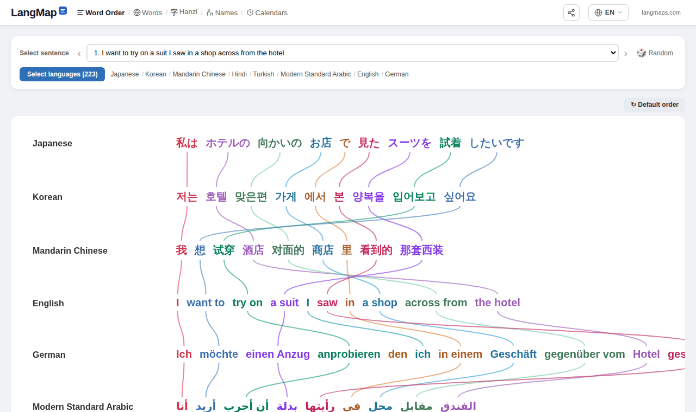
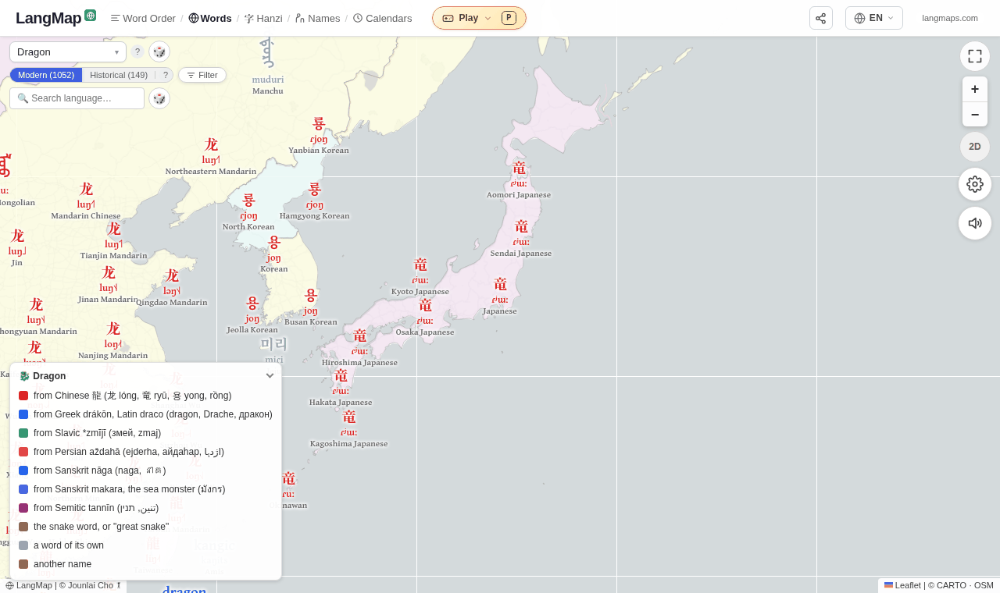
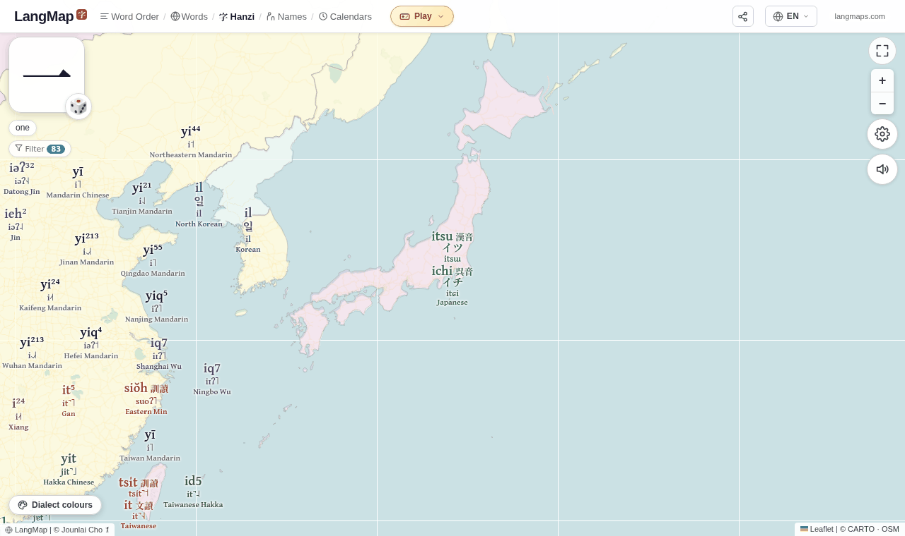
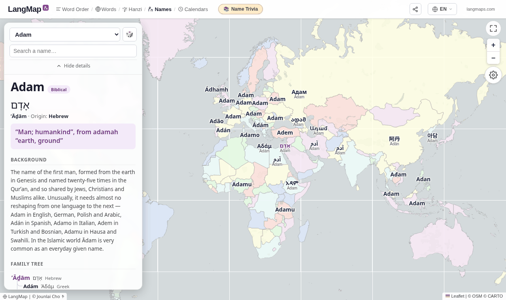
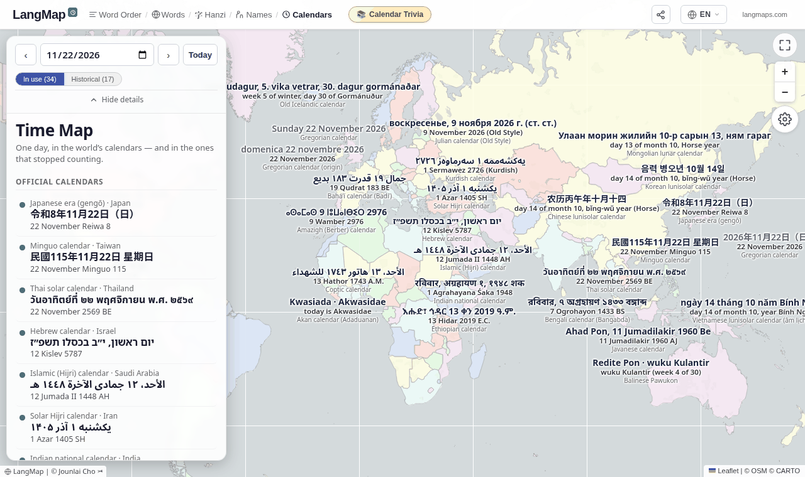
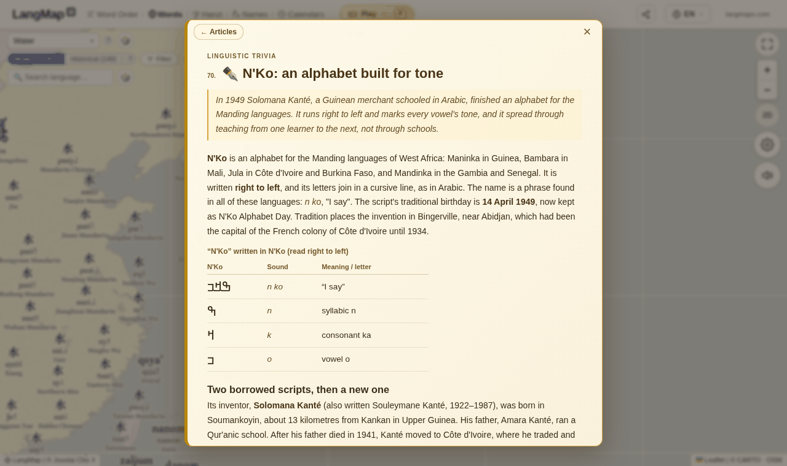
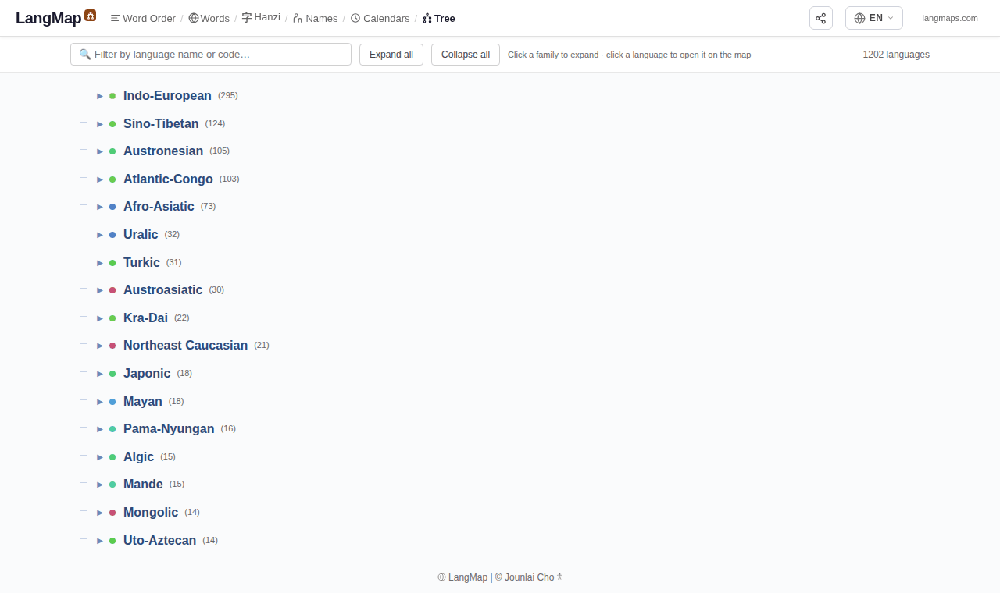

# LangMap — atlases of the world's languages


**LangMap** is a family of interactive maps for people who love languages: how word order differs, what one word
sounds like in a thousand languages, how a Han character is read across East Asia, how a given name travels, and what
today's date is in the world's calendars. Every page runs in 19 UI languages.

**Live site:** [langmaps.com](https://langmaps.com)  
**GitHub:** [github.com/jounlai/langmap](https://github.com/jounlai/langmap)  
**What changed recently:** [changelog](https://langmaps.com/changelog.html)

Inspired by [sunjun_kim's language mapping graphic](https://twitter.com/sunjun_kim).

## The maps

Figures as of November 2026. The pages and the changelog always carry the current ones.

| Page | What it shows |
|---|---|
| [Word Order Map](https://langmaps.com/) (`index.html`) | 100 sentences in 223 languages and dialects, cut into colour-coded segments; curved lines join the same meaning across languages, so SOV, SVO and VSO orders are visible at a glance. Drag to reorder, edit inline, export PNG/SVG. |
| [Word Map](https://langmaps.com/wordmap.html) (`wordmap.html`) | 167 everyday words (water, mother, hello, coffee, dragon…) in 1,197 languages, about 100 of them historical, each with IPA or a broad transcription. Cells are coloured by where the word came from (its route), with a compare panel, a 2D map / 3D globe and filters by family, script, word order, tone and morphology. |
| [Han Map](https://langmaps.com/hanmap.html) (`hanmap.html`) | 134 Han characters read in 110 Sinitic varieties, Japanese, Korean and Vietnamese layers, and historical stages (Old and Middle Chinese, Middle Korean, Chữ Nôm, Tangut, Khitan, Phags-pa…). |
| [Name Map](https://langmaps.com/namemap.html) (`namemap.html`) | 62 given names (John, Mary, Muhammad, Alexander…) as written and pronounced country by country, with origins, meanings, family trees and notable bearers. |
| [Time Map](https://langmaps.com/timemap.html) (`timemap.html`) | Any day in 51 calendars, current and historical: Japanese era, Minguo, Thai Buddhist, Chinese lunisolar, Hebrew, Islamic, Persian, Ethiopian, French Republican, Maya Long Count… |
| [Family Tree](https://langmaps.com/tree.html) (`tree.html`) | Every Word Map language in a genealogical dendrogram; click a leaf to jump to the map. |

### Screenshots

| | |
|---|---|
| <br>**Word Order Map**: one sentence, segment by segment | <br>**Word Map**: "dragon" in East Asia, coloured by origin |
| <br>**Han Map**: 一 read across the Sinosphere | <br>**Name Map**: Adam, country by country |
| <br>**Time Map**: one day in the world's calendars | <br>**Articles**: N'Ko, with an example table |
| <br>**Family Tree** | |

**Reading material.** 296 long-form articles live inside the maps: Word Map 196, Han Map 60, Name Map 20, Time Map 20.
They cover word stories, scripts, sound changes and calendar history. Each is in all 19 UI languages, sourced, and
cross-checked in review rallies (`trivia_reviews/`). Buttons in an article move the map, and example tables show the
scripts and forms the text talks about.

**Sinosphere corner.** [langmaps.com/sinosphere/](https://langmaps.com/sinosphere/) republishes the English posts
from the SINOSPHERE 漢字文化圈 Facebook group: 53 articles as of November 2026, on Han characters, words and sounds
across China, Japan, Korea and Vietnam. Each ends with a link to the matching map. English only; static pages built
from Markdown in `sinosphere/posts/`. The format and the add-a-post steps are in
[`sinosphere/GUIDE.md`](sinosphere/GUIDE.md).

**Crawlable pages.** Server-rendered pages for every language and article (`/{ui}/wordmap/{lang}`,
`/{ui}/hanmap/{lang}`, trivia, sitemaps) in PHP. See [`seo/README.md`](seo/README.md).

## Running it locally

No build step for the pages themselves. Serve the folder with any static server:

```bash
python3 -m http.server 8080      # then open http://localhost:8080
```

For the server-rendered pages, use `php -S localhost:8080 router.php`.

## Repository layout (main pieces)

```
index.html, app.js, data.js          Word Order Map (sentences × languages)
wordmap.html                         Word Map page
  words/<word>.js                    one file per word: cells (form, IPA), routes, notes
  wordmap_meta.js                    language metadata — SOURCE OF TRUTH; lite/desc/i18n slices are generated
  wordmap_trivia.js (+ _<ui>.js)     Word Map articles (en+ja, then one overlay per UI language)
hanmap.html, hanmap_data.js          Han Map; hanmap_trivia.js holds its articles in all 19 languages
namemap.html, namemap_data.js        Name Map; namemap_trivia.js
timemap.html, timemap_calendars.js   Time Map; timemap_trivia.js
trivia_reader.js                     shared article reader for Name Map and Time Map
sinosphere/posts/<date>_<slug>/      Sinosphere corner: one post.md + images per article (SOURCE);
                                     the rest of sinosphere/ is GENERATED by tools/build_sinosphere.py
*_trivia_rt/, *.br, data/*.json      GENERATED runtime slices, compressed copies, SEO exports
fonts/                               self-hosted font subsets for historic and rare scripts
seo/                                 server-rendered pages (PHP)
tools/                               builders and data guards (see below)
docs/                                guides: words/CONTRIBUTING.md, words/LANG_CODES.md, trivia-writing-guide.md
*_reviews/                           review-rally records, one file per round
```

Language codes for every row are listed in [`docs/words/LANG_CODES.md`](docs/words/LANG_CODES.md).

## Checking a change

All data is guarded by deterministic checks. Run them before every commit:

```bash
node tools/check_all.js            # every guard; must end with "all guards clean"
```

Generated files must be rebuilt after editing their source. The common cases:

| You edited | Then run |
|---|---|
| `wordmap_meta.js` | `node tools/build_meta_split.js` |
| `words/*.js` | `node tools/build_lang_words.js`; new glyphs need `node tools/build_historic_font_subsets.js` |
| Han Map articles | `node tools/build_hanmap_trivia_rt.js` |
| Name Map or Time Map articles | `node tools/build_trivia_rt.js`, then `python3 tools/build_cjk_page_subsets.py` |
| any article | `node tools/export_trivia_seo.js` and `node tools/build_seo_sitemaps.js` |
| `sinosphere/posts/*` | `python3 tools/build_sinosphere.py build` (new Facebook posts: `… import <export dir>` first) |
| any shipped asset | `node tools/page_asset_version_check.js --bump`, `node tools/bump_versions.js`, `node tools/build_br.js` |

`check_all.js` names the step you missed.

## Contributing

- Word data: [`docs/words/CONTRIBUTING.md`](docs/words/CONTRIBUTING.md) ([日本語](docs/words/CONTRIBUTING.ja.md)).
- Articles: [`docs/trivia-writing-guide.md`](docs/trivia-writing-guide.md). It covers the hard rules (sources, no
  invented quotes, all 19 languages), separators, Han-term notation per language, and example tables.
- Sinosphere posts: [`sinosphere/GUIDE.md`](sinosphere/GUIDE.md) (Japanese).
- The one rule above all: never fabricate. Every form, reading and claim needs a source.

## Author

**趙 俊来** (Jounlai Cho) — [ヒューロン株式会社](https://heuron.com)  
Contact: cho@heuron.com | X: [@jounlai](https://x.com/jounlai)

## License

MIT

---

# LangMap — 世界の言語の地図帳


**LangMap** は言語好きのためのインタラクティブな地図のシリーズです。扱うのは次のようなことです。
- 語順の違い
- 一つの単語が千の言語でどう聞こえるか
- 漢字が東アジアでどう読まれるか
- 名前がどう旅をするか
- 今日が世界の暦で何日にあたるか

どのページも19のUI言語に対応しています。

**公開サイト:** [langmaps.com](https://langmaps.com)  
**GitHub:** [github.com/jounlai/langmap](https://github.com/jounlai/langmap)  
**最近の変更:** [変更履歴](https://langmaps.com/changelog.html)

[sunjun_kim氏の言語マッピング画像](https://twitter.com/sunjun_kim)に着想を得ています。

## 地図

数字は2026年11月時点のものです。最新の数字は各ページと変更履歴にあります。

| ページ | 内容 |
|---|---|
| [語順マップ](https://langmaps.com/)（`index.html`） | 223の言語・方言で100の文を、色分けした意味のまとまりに区切って並べる。同じ意味の部分を曲線で結ぶので、SOV・SVO・VSOの違いが一目で分かる。ドラッグで並べ替え、その場で編集、PNG/SVGで書き出しができる。 |
| [単語マップ](https://langmaps.com/wordmap.html)（`wordmap.html`） | 1,197言語（うち約100は歴史言語）で167の身近な語（水、母、こんにちは、コーヒー、竜…）を、IPAまたは簡易表記つきで表示する。語の由来（系統）ごとに色分けし、比較パネル、2D地図／3D地球儀、語族・文字・語順・声調・形態論のフィルタがある。 |
| [漢字マップ](https://langmaps.com/hanmap.html)（`hanmap.html`） | 134の漢字を110の変種で読む。中国語諸方言、日本語・韓国語・ベトナム語の読み、歴史的段階（上古・中古漢語、中世韓国語、字喃、西夏文字、契丹文字、パスパ文字…）を含む。 |
| [名前マップ](https://langmaps.com/namemap.html)（`namemap.html`） | 62の名前（John、Mary、Muhammad、Alexander…）の国ごとの綴りと発音。由来、意味、系統図、有名人もつけている。 |
| [暦マップ](https://langmaps.com/timemap.html)（`timemap.html`） | 現行・歴史上の51の暦で任意の日を表示する。元号、民国紀元、仏暦、農暦、ヘブライ暦、ヒジュラ暦、イラン暦、エチオピア暦、フランス革命暦、マヤ長期暦など。 |
| [系統樹](https://langmaps.com/tree.html)（`tree.html`） | 単語マップの全言語を系統樹で表示する。葉をクリックすると地図へ移動する。 |

### スクリーンショット

| | |
|---|---|
| <br>**語順マップ**：一つの文を意味のまとまりごとに比べる | <br>**単語マップ**：東アジアの「竜」、由来ごとに色分け |
| <br>**漢字マップ**：漢字文化圏での「一」の読み | <br>**名前マップ**：国ごとの Adam |
| <br>**暦マップ**：同じ一日を世界の暦で | <br>**読み物**：ンコ文字の記事と例示表 |
| <br>**系統樹** | |

**読み物。** 地図の中に296本の記事がある（単語マップ196、漢字マップ60、名前マップ20、暦マップ20）。
- 語源の物語、文字、音の変化、暦の歴史を扱う。
- どれも19言語すべてで読め、出典つきで、レビューラリー（`trivia_reviews/`）で検証している。
- 記事内のボタンを押すと地図が動き、例示表には本文で触れた文字や語形を載せている。

**Sinosphere コーナー。** [langmaps.com/sinosphere/](https://langmaps.com/sinosphere/) は、Facebook グループ SINOSPHERE 漢字文化圈 に投稿した英語記事をサイトで読めるようにした独立コーナー。
- 2026年11月時点で53本。中国・日本・韓国・ベトナムの漢字、語、音を扱う。
- 英語のみ。各記事の最後に対応する地図へのリンクがある。
- `sinosphere/posts/` の Markdown から静的ページを生成する。形式と追加手順は [`sinosphere/GUIDE.md`](sinosphere/GUIDE.md)。

**クロール用ページ。** すべての言語と記事について、サーバー側で描画したページ（`/{ui}/wordmap/{lang}` など）を PHP で生成している。詳しくは [`seo/README.md`](seo/README.md) を参照。

## ローカルでの起動

ページ自体にビルドは不要です。任意の静的サーバーで配信します。

```bash
python3 -m http.server 8080      # http://localhost:8080 を開く
```

サーバー描画ページは `php -S localhost:8080 router.php` で確認できます。

## 主なファイル

英語版の「Repository layout」を参照してください。要点は次のとおりです。
- `words/<word>.js` が単語ごとのデータ（語形・IPA・系統・注記）。
- `wordmap_meta.js` が言語メタデータの**正本**。分割ファイルは生成物。
- `*_trivia.js` が記事の本体。`*_trivia_rt/`、`*.br`、`data/*.json` は**生成物**なので直接編集しない。
- `sinosphere/posts/<日付>_<slug>/post.md` が Sinosphere 記事の**正本**。`sinosphere/` のそれ以外は `tools/build_sinosphere.py` の生成物。
- 言語コードの一覧は [`docs/words/LANG_CODES.md`](docs/words/LANG_CODES.md) にある。

## 変更の確認

すべてのデータは決定的なチェックで守られています。コミット前に必ず実行します。

```bash
node tools/check_all.js            # 最後に "all guards clean" と出れば OK
```

元データを編集したら、生成物を作り直します。手順は英語版の表のとおりです。抜けている工程は `check_all.js` が名指しで教えてくれます。

## コントリビューション

- 単語データ：[`docs/words/CONTRIBUTING.ja.md`](docs/words/CONTRIBUTING.ja.md)
- 記事：[`docs/trivia-writing-guide.md`](docs/trivia-writing-guide.md)。出典、引用の捏造禁止、19言語すべて、区切り記号、言語ごとの漢字語表記、例示表について定めている。
- Sinosphere 記事：[`sinosphere/GUIDE.md`](sinosphere/GUIDE.md)。FB からの取り込み、形式、タグ、公開前チェックリスト。
- 何より大事な決まりは、捏造しないこと。語形・読み・主張のすべてに出典が要る。

## 制作

**趙 俊来**（Jounlai Cho） — [ヒューロン株式会社](https://heuron.com)  
連絡先: cho@heuron.com | X: [@jounlai](https://x.com/jounlai)

## ライセンス

MIT
