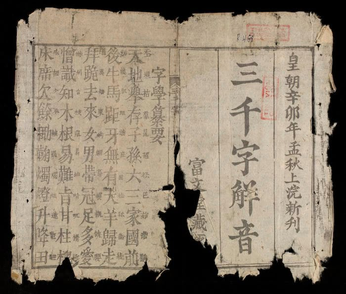
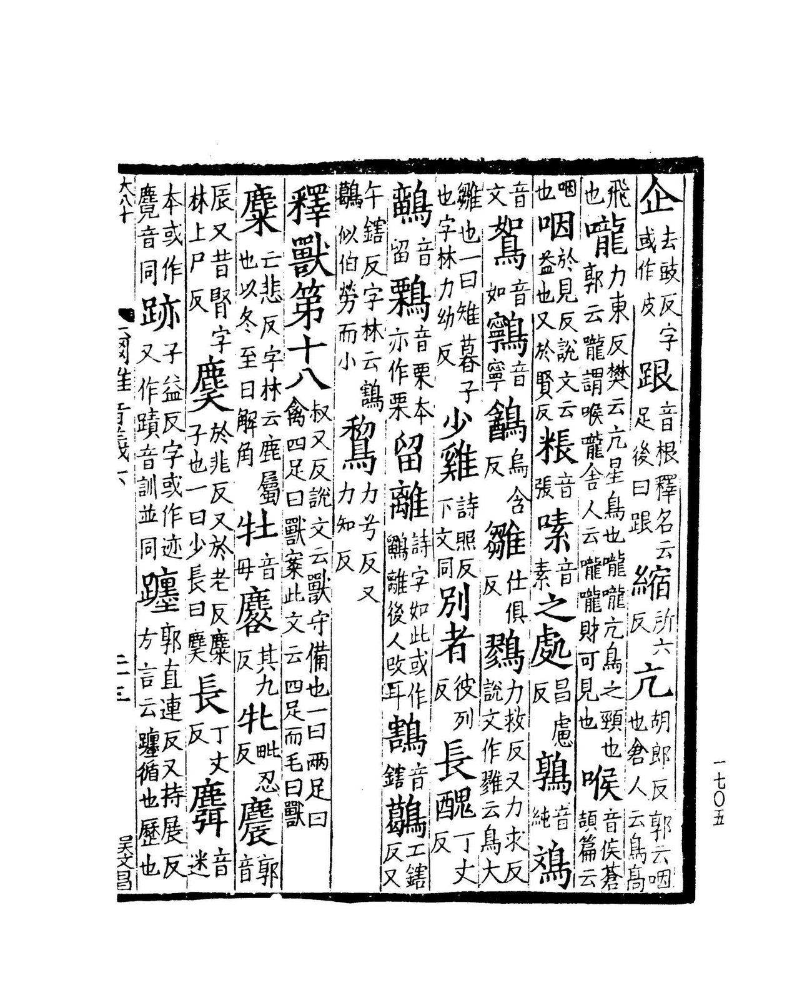

## Two labels for one character

Korean Hanja textbooks give each character two labels.

> **水** = **물 수**
>
> **물** (*mul*) tells you what it means: "water."
> **수** (*su*) tells you its Sino-Korean reading.

This pairing is called **훈음 (訓音)** *hun-eum*, literally "gloss and sound."

> **山** = **메 산** (*me san*)
> **水** = **물 수** (*mul su*)
> **人** = **사람 인** (*saram in*)
> **木** = **나무 목** (*namu mok*)

**메** *me* is an old word for "mountain" that modern Korean has otherwise given up in favour of **산** itself. It survives mainly in this label and in compounds such as **멧돼지** *metdwaeji*, "mountain pig," the wild boar.

## A system five centuries old

The system is old.

Korean children learned characters from the Thousand Character Classic (**千字文**), a 6th-century Chinese primer. Once the Korean alphabet existed, from 1446, a primer could spell out both the gloss and the sound of every single character.

The 1527 **訓蒙字會** *Hunmong Jahoe* did this systematically for 3,360 characters, teaching each one with its Korean meaning and its Sino-Korean pronunciation. The oldest surviving glossed Thousand Character Classic was printed in Gwangju in 1575, and the most famous one, written out by the calligrapher Han Seok-bong, in 1583.

The format has barely changed since. The page at the top of this article comes from a later Korean edition of the Thousand Character Classic: beside each large character sit two small hangul labels, the native word and the Sino-Korean syllable, exactly like a modern textbook.

But Korea was not alone.

Across the Sinosphere, people faced the same problem: how do you learn Chinese characters when the language you actually speak is not Chinese?

## Vietnam: the mirror image

Vietnam developed something strikingly similar.

The old primer **三千字解音** *Tam thiên tự giải âm* taught Chinese characters together with their Sino-Vietnamese reading and a native Vietnamese gloss, written in Chữ Nôm.

> **天** **𡗶**
> *thiên* *trời*
>
> **地** **坦**
> *địa* *đất*

So Korean **물 수** and Vietnamese *thiên trời* are almost mirror images.

Korean puts the native meaning first, then the Sino-Korean sound.

Vietnamese put the Sino-Vietnamese sound first, then the native Vietnamese meaning.

## Japan: the gloss became a reading

Japan had related traditions too.

In a reading practice later called **文選読み** *monzen-yomi*, a Chinese word could be read first with its Sino-Japanese pronunciation and then immediately explained with a native Japanese word.

> **豺狼**
> *sairō no ōkami*
>
> First the Chinese-derived reading, then "wolf" in Japanese.

But Japan eventually took the idea much further.

The native Japanese word became an actual reading of the character itself. **山** is not merely explained as *yama*. You can write **山** in an ordinary Japanese sentence and simply read it *yama*.

Modern Korean works differently.

The **메** in **메 산** tells the learner what **山** means, but **山** itself is read *san* when used as Hanja. The native Korean gloss normally remains a label for learning the character, a memory aid rather than a live reading.

It was not always so. Old Korean scribes writing their own language in characters, in the *idu* and *hyangchal* systems, did read some characters by their native meaning. A trace survives in the names of two Korean letters, first recorded in that 1527 primer. Its author, Ch'oe Sejin, could find no character pronounced *-geut* or *-ot*, so he spelled the name of ㄷ as **池末** and ㅅ as **時衣**, and marked **末** "end" and **衣** "clothes" to be read by their native glosses, **귿** and **옷**. That is why the letters are still called **디귿** *digeut* and **시옷** *siot*.

Vietnam took yet another path. Sino-Vietnamese readings such as *thiên* remained associated with Chinese vocabulary, while native words such as *trời* could also be written separately in Chữ Nôm.

## China: sound and meaning, both in Chinese

China itself had an older **音義** tradition. Works such as the **經典釋文** *Jingdian Shiwen* gave both the pronunciation and the meaning of difficult characters.

But there was one fundamental difference: both the sound and the explanation belonged to Chinese. There was no second native language to map onto the character.

## One problem, four solutions

So the same basic problem produced different solutions across the Sinosphere:

Korea kept the native word mainly as a meaning label.

Japan turned native words into regular character readings.

Vietnam paired Sino-Vietnamese readings with native Vietnamese words, even writing those native words in Chữ Nôm.

China explained sound and meaning within Chinese itself.

**One writing system, four different ways of connecting a character to the spoken language.**
