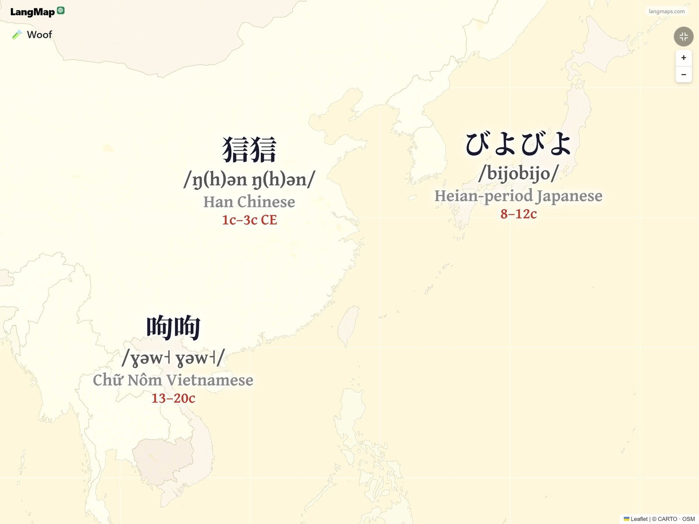

## One bark, many spellings

Today, dogs around East Asia sound very different on paper:

> Japanese: **ワンワン** (*wan-wan*)
> Mandarin: **汪汪** (*wāng-wāng*)
> Korean: **멍멍** (*meong-meong*)
> Vietnamese: *gâu gâu*
> English: *woof* or *bow-wow*

The map goes further. Okinawan dogs say **わうわう** (*wau-wau*), Mongolian dogs **хав хав**, Thai dogs **โฮ่ง ๆ** (*hong hong*), and Malay dogs *gonggong*.

Of course, the dogs themselves are not speaking different languages.

People are fitting roughly the same animal sound into the sound system and conventions of their own language. A bark has no real consonants, so each language squeezes it into the consonants it owns: a *w* in Japanese and Mandarin, an *m* in Korean, a *g* in Vietnamese, a breathy *h* in Thai.

Nearly everybody agrees on one thing: say it twice. Thai even has a special sign, **ๆ**, that tells you to repeat the word.

And those conventions can change.

## Japan: before wan-wan

Go back about a thousand years in Japan.

In the Heian-period *Ōkagami* (**大鏡**), a dog's bark is written **ひよ** *hiyo*.

That looks nothing like *wan-wan*.

But early Japanese manuscripts often omitted the marks used to distinguish voiced sounds, so it is generally interpreted as something closer to **びよ** *biyo*. The Word Map gives the Heian-period bark as **びよびよ** *biyo-biyo*.

Later texts also have forms such as *byō*.

*Biyo* and *byō* survived well into the Edo period, while *wan-wan* gradually appeared and eventually became the familiar form used today.

## China: before wāng-wāng

China gives us an even older example.

Modern Mandarin uses **汪汪** *wāng-wāng*.

And **汪汪** itself is not new. It was already used for barking in texts from centuries ago.

But Classical Chinese also had **狺狺** *yín-yín*.

The word specifically represented the sound of dogs barking.

It appears in the *Chuci* (**楚辭**), in "Nine Changes" (**九辯**):

> **猛犬狺狺而迎吠**
> "Fierce dogs came forward barking *yín-yín*."

The Word Map places **狺狺** in Han-period Chinese, roughly the 1st to 3rd centuries CE, and reconstructs it with an initial *ŋ-*, a sound modern Mandarin no longer has at the start of a word.

## Korea and Vietnam

So if we move backwards through time:

> Modern Japanese: **ワンワン** *wan-wan*
> Heian and later Japanese: **びよ** *biyo* / **びょう** *byō*
>
> Modern Mandarin: **汪汪** *wāng-wāng*
> Classical Chinese: **狺狺** *yín-yín*

What about Korea and Vietnam?

Modern Korean has **멍멍** *meong-meong*, and Vietnamese has *gâu gâu*.

When this was first posted, I had not found a securely attested historical dog-bark expression in older Korean or Vietnamese texts comparable to Japanese *biyo* or Classical Chinese **狺狺**, and asked whether anyone knew an old Korean example, or a Chữ Nôm text that writes the sound of a barking dog.

Thanks to Phùng Đức Bình, that Chữ Nôm gap has now been filled. A Nôm dictionary writes *gâu* with **呴**, a character built from **口** "mouth" + **句**, so the bark becomes **呴呴** *gâu gâu*. The Word Map now shows it for Chữ Nôm Vietnamese.

The Korean gap is still open. If anyone knows an old Korean example, I would love to see it.

## No correct answer

English has its own history too. Shakespeare spelled the bark his own way in *The Tempest*, where the watch-dogs go *bowgh wawgh*.

The interesting part is not which language hears the dog "correctly."

There may be no correct answer.

Onomatopoeia imitates sound, but it is still shaped by language.

**And language changes.**
