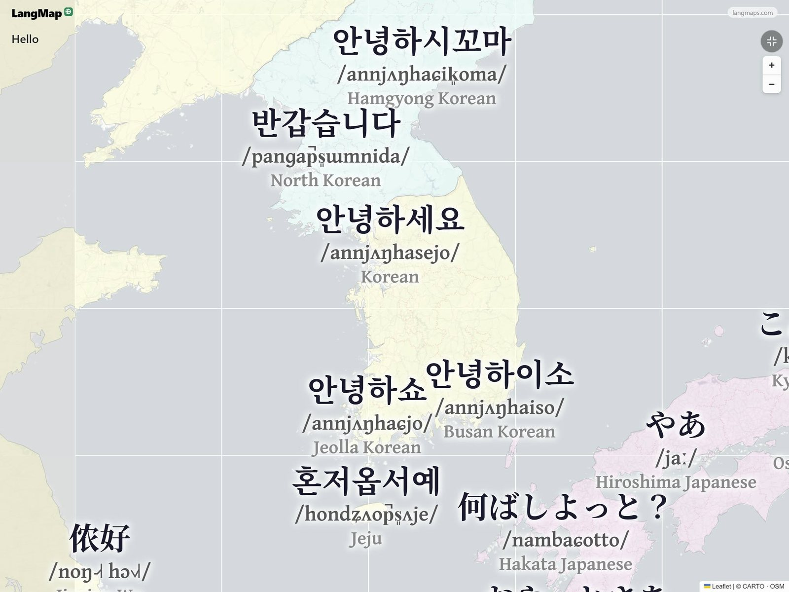

## A picnic called 逍風

This series looks at words whose characters are familiar across the Sinosphere but whose everyday meanings are not. It begins in Korea.

A Korean child looking forward to a school outing calls it **소풍** (*sopung*). Write its underlying characters, and it becomes **逍風**.

For someone unfamiliar with Korean, those characters might suggest a literary excursion: **逍**, familiar from **逍遙**, beside **風**, "wind." In Korean, however, it is an ordinary word for a picnic or outing, including the school trip for which children pack their lunches.

Most Korean writing today uses Hangul. Restoring the characters behind Sino-Korean words reveals connections that their everyday spelling leaves out of sight.

## Guilt, peace and old acquaintances

Consider **죄송** (*joesong*), the basis of the polite apology **죄송합니다**. Its characters are **罪悚**: guilt and fear. The written form looks rather solemn beside its everyday function, "I'm sorry."

Or **안녕** (*annyeong*), written **安寧**. Readers of Chinese characters may associate it with peace and tranquillity. Korean speakers also use it as a casual greeting or farewell. A word that can describe the peaceful condition of a country can also pass between two friends meeting on the street.

On the map of "hello," that peace turns up across the peninsula: Seoul's **안녕하세요**, Busan's **안녕하이소**, Jeolla's **안녕하쇼**, Hamgyong's **안녕하시꼬마**. Each one is, underneath, a question about whether you are **安寧**. Not every row joins in: the map's North Korean entry is **반갑습니다**, "pleased to meet you," and Jeju has **혼저옵서예**, a word of welcome.

The same peace also says goodbye. **안녕히 가세요** sends off someone who is leaving, and **안녕히 계세요** is said to someone who stays: go in peace, stay in peace.

Those friends are **친구** (*chingu*), or **親舊**. In Chinese, 親舊 is a literary expression for relatives and old acquaintances. In Korean, a friend made yesterday can already be a 친구.

And a wallet is **지갑** (*jigap*), written **紙匣**, literally a paper box, even when it is made of leather.

## An entirely ordinary afternoon

These words have different histories. Some preserve older vocabulary; others developed meanings particular to Korean. They share one useful lesson: recognizing the characters does not always reveal what the speaker means.

> **逍風**, **親舊**, **安寧**
>
> On the page, they might resemble the vocabulary of an old literary gathering.

**In Korean, they belong to an entirely ordinary afternoon.**
