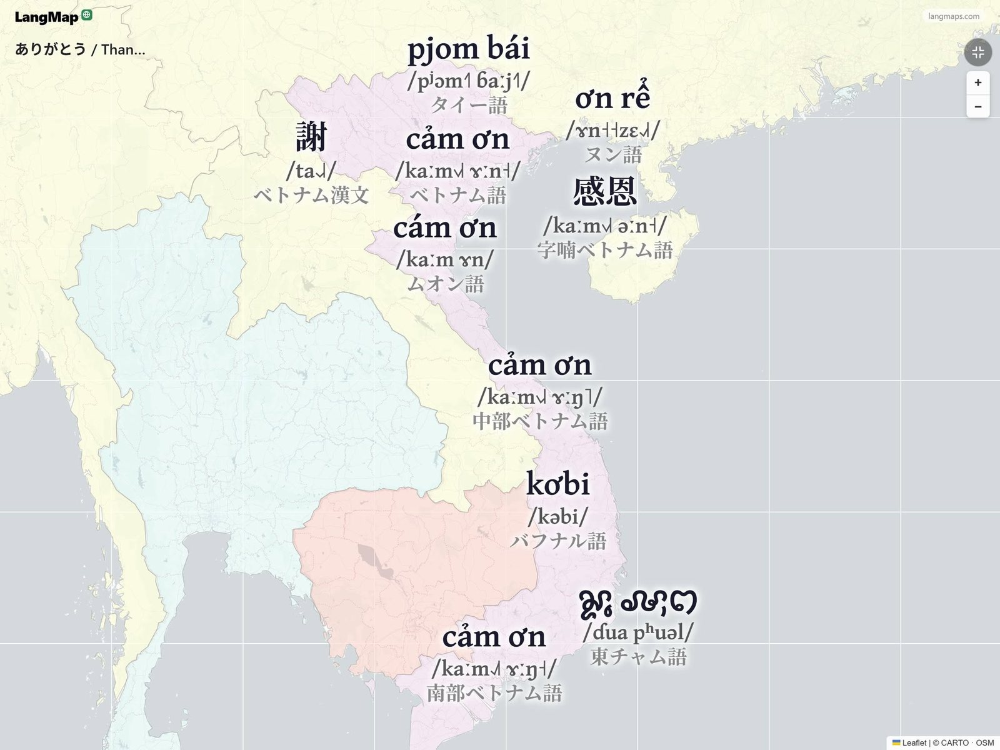

## A student called 生員

A university student in Vietnam is a **sinh viên**. In characters, that is **生員**.

Readers familiar with Chinese history may recognize the name of a student status associated with the imperial examination system. In present-day Vietnamese, it is an ordinary term for someone attending university.

Modern Vietnamese generally writes these words in the Latin alphabet. Putting their historical characters back beside them makes the distance between their present use and their older associations visible.

## A water clock, a scholar's study

A clock or watch is **đồng hồ**, written **銅壺**. The name comes from the copper vessel of a water clock. The vessel disappeared from modern timekeeping, but its name continued: a smartwatch is still a kind of *đồng hồ*.

An office is **văn phòng**, or **文房**. For readers who know **文房四寶**, the characters suggest a scholar's study, with brush, ink, paper and inkstone. In Vietnamese, they can refer to an office full of computers and photocopiers.

## A fee that moistens the brush

My favourite example is **nhuận bút**: **潤筆**.

It means payment for writing or other creative work, commonly encountered in publishing and journalism. **潤筆** survives in Chinese too, as an elegant expression for remuneration for writing, calligraphy or painting. Vietnamese gives it a regular place in the practical business of paying authors.

There is something pleasing about that. A payment can arrive by bank transfer, yet its name still says "moisten the brush."

Even "thank you" has characters behind it. Everyday **cảm ơn** is written **感恩** in Chữ Nôm, "to feel a kindness," while classical Vietnamese writing in Chinese simply used **謝**.

## The life of a scholar, read as Vietnamese

A **生員** checks a **銅壺**, goes to a **文房** and receives **潤筆**. Read through their older associations, these words suggest the life of a scholar. Read as Vietnamese, they describe a student, a watch, an office and a fee.

Some old words survived abroad after receding from everyday Chinese. Others remained in Chinese but acquired different uses elsewhere. Their histories are varied, but each offers the same small surprise.

**A familiar written form can belong to a life we did not expect.**
