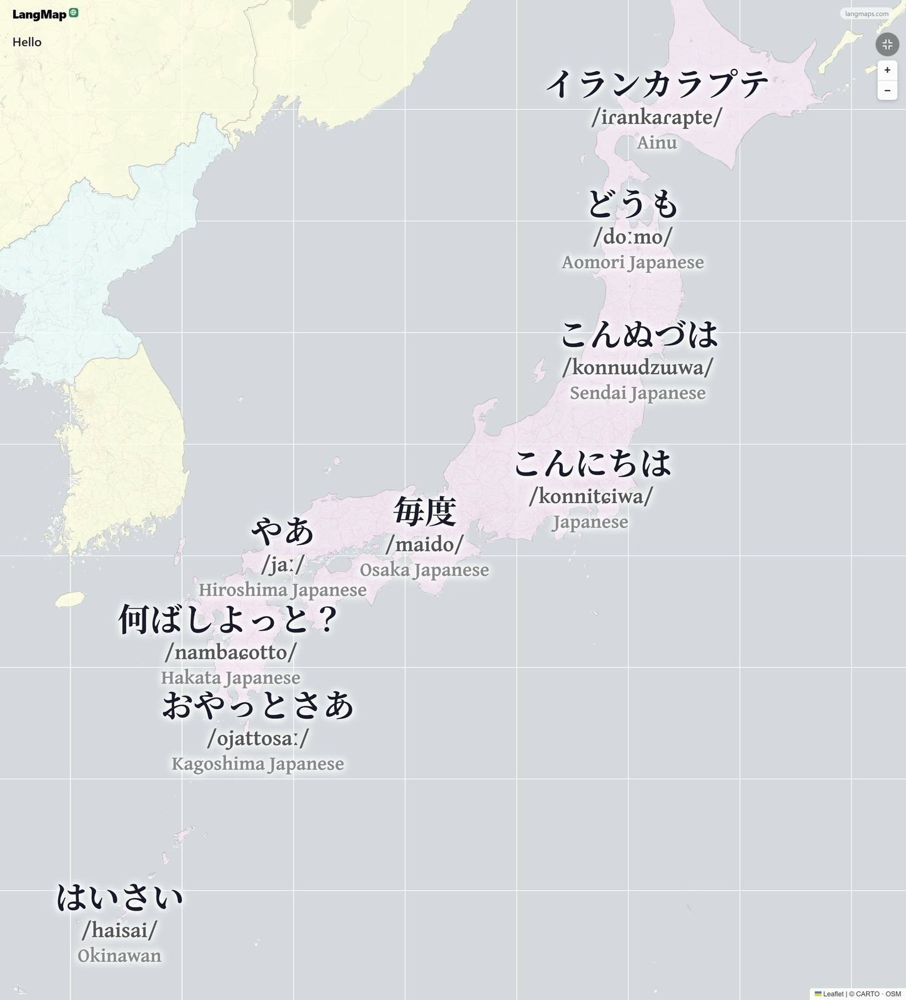

## "大丈夫?"

After Korea and Vietnam, this series reaches Japan, where some of the most familiar characters do the most unexpected work.

Someone falls over. A Japanese speaker asks, **"大丈夫?"**

For a reader who knows only the Chinese meaning, this is an unexpected moment to mention a man of courage and integrity.

Japanese **大丈夫** (*daijōbu*) ordinarily means "okay," "safe" or "no problem." Chinese **大丈夫** still describes a principled, resolute man. The characters are shared; their everyday jobs are different.

## From the ego to endurance

**我慢** (*gaman*) offers another striking change. In Buddhist terminology, it refers to attachment to the self and conceit. In everyday Japanese, it means enduring discomfort or restraining an impulse. A term for an assertive ego became a word used when holding oneself back.

**達者** (*tassha*) can suggest someone who understands the ways of the world. Japanese also uses it for skill and good health: **口が達者** describes someone skilled with words, while **お達者で** wishes someone well.

**挨拶** (*aisatsu*) developed from usage in Zen exchanges into the ordinary word for greetings. Those greetings vary across the country: standard **こんにちは**, Okinawan **はいさい**, and in Osaka a shopkeeper's **毎度**, literally "every time."

**喧嘩** (*kenka*) means a quarrel or fight in Japanese; Chinese **喧嘩**, also written **喧譁**, describes noisy clamour and does not necessarily imply a fight.

## A creature beneath a stele

Then there is **贔屓** (*hiiki*).

Japanese speakers use it for favouring someone or supporting a favourite performer, team or shop. A reader familiar with Chinese **贔屭** may instead picture the legendary tortoise-like creature beneath a stone stele.

The older expression also described exerting strength. Japanese usage developed towards exerting oneself on someone's behalf, and hence favouring or supporting them. The mythical creature and the everyday preference share a written history, though their connection is rarely present in a speaker's mind.

## Words changing through use

These are familiar Japanese words. Some of their Chinese counterparts remain familiar too, but with different meanings; others belong largely to historical or specialist vocabulary.

That distinction matters. This is not simply a collection of ancient words preserved in Japan. In the final part, the series turns to China itself.

**It is also a record of words changing through use, until even readers who recognize every character need a translation.**
