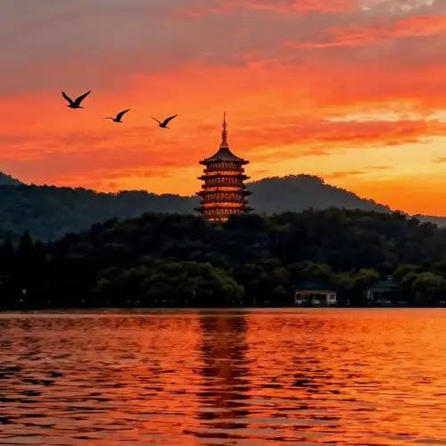
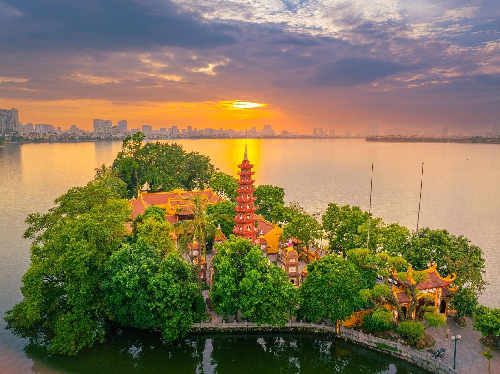
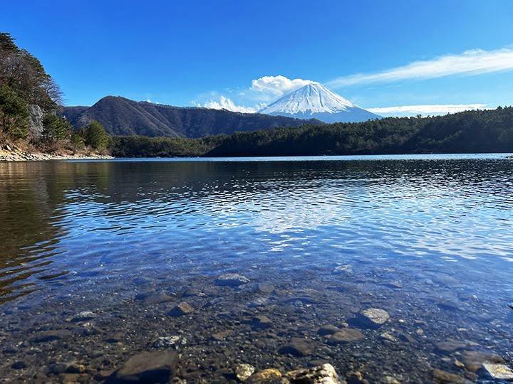

## Three lakes, one name

In Hangzhou, China:

> **西湖**
> *Xīhú*

In Hanoi, Vietnam:

> **西湖**
> *Tây Hồ* (Sino-Vietnamese)
> *Hồ Tây* (everyday Vietnamese)

Near Mount Fuji, Japan:

> **西湖**
> *Saiko*

Exactly the same two characters.

**西** means west.
**湖** means lake.

Simply, "West Lake."

But how did three famous lakes end up with the same name?

## China: a lake that became a legend

Hangzhou's West Lake is one of China's most celebrated landscapes.

For centuries, poets, painters and emperors admired its beauty.

Its name became so famous that other lakes across East Asia were compared to it, and sometimes even named after it.

In 2011, West Lake became a UNESCO World Heritage Site.

## Vietnam: a lake that changed its name

Hanoi's West Lake has a very different history.

It was once known as:

> **淫潭**
> *Dâm Đàm*

Its older legends tell of a nine-tailed fox, a dragon and a golden buffalo.

The name **Tây Hồ (西湖)** became established in the late 16th century.

According to a traditional explanation, the change was connected to a royal naming taboo: the old name contained a character used in a king's personal name.

The lake had existed for centuries.

**But the name we know today came later.**

In everyday Vietnamese, *Tây Hồ* becomes *Hồ Tây*, with the noun "lake" placed first. That is the native Vietnamese word order, head noun first; the Sino-Vietnamese form keeps the Chinese order, modifier first.

## Japan: a lake reshaped by fire

Near Mount Fuji lies another 西湖.

Its history is written in lava.

In **864**, Mount Fuji erupted.

Lava flowed across an ancient lake known as *Senoumi* (剗の海), dividing it and helping create today's Lakes Saiko and Shōjiko.

While China's West Lake became a symbol of classical beauty, and Vietnam's changed its name through history, Japan's landscape was transformed by a volcano.

## One more curious connection

There is a story that connects the West Lakes of Hangzhou and Hanoi.

A heavenly mirror shattered.

One piece fell in China.

The other in Vietnam.

Both became lakes called **西湖**.

The Chinese poet Xia Chengtao (夏承燾) recorded a version in 1965.

Researchers suggest the story may have been reshaped or popularized in the 20th century as a symbol of friendship between China and Vietnam.

Its ancient origins remain unverified.

**Perhaps the story connecting these ancient lakes is surprisingly modern.**

## Three lakes, three histories

One lake celebrated in Chinese poetry.

One lake renamed in Vietnamese history.

One lake reshaped by Japanese volcanic fire.

And a mirror legend that may have connected two of them much later.

> **西湖**
> Two characters. Three languages. Three different histories.

**The names look identical. The stories behind them are anything but.**
